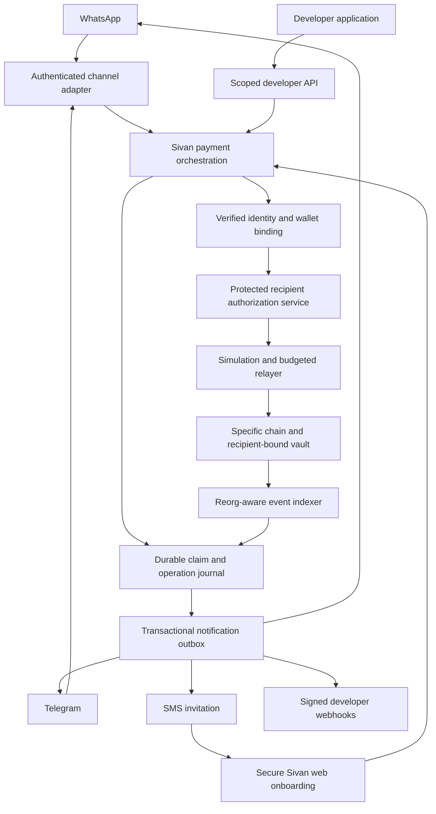

# Sivan recipient-bound payments and claims

Version: 0.1 — 16 October 2026

Status: proposed implementation specification, not implemented functionality or
release approval. This document describes a new recipient-bound claim product.
It does not change any deployed contract, authorize production transactions, or
supersede the existing [bearer-link v1 specification](../integration/CLAIM_VAULT.md).
Policy decisions marked OPEN require explicit approval before implementation.

## 1. Product objective

A sender can pay an intended phone-number recipient who has never used crypto.
The recipient can onboard through WhatsApp or a secure web experience, obtain a
supported wallet through the existing Sivan wallet service, and explicitly claim.
Telegram and authorized developer applications use the same backend lifecycle.
SMS is an optional invitation channel, not a separate payment or authorization.

The recipient must not need to buy gas or manage a seed phrase when an approved
embedded-wallet and sponsorship configuration supports that experience. Do not
promise either capability before it is deployed, funded and verified. Explain
wallet custody, signing control and recovery accurately for the chosen provider.

Essential product promise: an invitation alone does not authorize collection;
the backend must verify the intended identity and bind authorization to its
approved wallet. On-chain enforcement validates that authorization, not a phone
number or the truth of a WhatsApp identity claim.

This is not an unconditional worldwide service. Availability depends on approved
network/token deployments, messaging reachability, product eligibility, provider
availability and jurisdiction-specific review. Bank cash-out is a separate flow
with its own supported countries, limits, fees and verification requirements.

## 2. Scope and repository ownership

| Repository | Responsibility |
| --- | --- |
| `sivan-contracts` | Separate immutable recipient-bound vault, verifier interface, tests, deployment/version adapters and contract documentation |
| `sivan-payment` | Canonical identity, wallet mapping, application isolation, claim orchestration, authorization service boundary, persistence, indexer, notifications and developer API |
| `whatsapp-bot` | Verified inbound-channel context, onboarding entry points, invitation/confirmation UI and truthful receipts |
| `Telegram-layer` | Equivalent Telegram interface and secure account linking; no independent payment engine |
| `sivan-user-frontend` | Shared secure web onboarding, transaction consent, status and sender refund UI, including SMS recipients without WhatsApp |
| Developer SDK/portal | Versioned client and capability documentation over the same payment API; exact repository to be confirmed |

Single-job and milestone agreement contracts are expressly out of scope. Do not
modify `SivanAgreementVault` or `SivanMilestoneVault`. Do not silently replace
existing bearer claims or internal-ledger claims with the new settlement model.
No automatic bridging, currency conversion, bank payout or cross-chain claim.

## 3. Evidence and current implementation

These are local-source observations, not claims about deployed service behavior:

 `contracts/SivanClaimVault.sol`: bearer signer per deposit, seven-day expiry,
  fixed 0.5% fee at funding, net-only sender refund after expiry. It has no phone
  verification or identity-bound recipient registration.
 `whatsapp-bot/src/handlers/messageDispatcher.ts`: existing onboarding sessions,
  names/tags, email-verification steps and PIN setup. Reuse after security review;
  their presence is not proof that recipient phone ownership is enforced.
 `whatsapp-bot/src/services/sivanApi.ts`: payment identity lookup and P2P API
  clients. These are integration points, not a Claim Vault adapter.
 `sivan-payment/src/identity/identity.routes.ts` and
  `src/wallets/user-wallet.service.ts`: chat identity resolution and wallet
  provisioning/reuse. Some reads can provision wallets; inspect before testing.
 `sivan-payment/src/balances/balance.service.ts`: existing unregistered-recipient
  claims create internal ledger holds, not on-chain deposits. The inspected
  redemption path does not establish intended phone ownership, can copy the
  claim phone to an unlinked recipient, and uses a non-cryptographic claim token.
 `sivan-payment/src/balances/balance.routes.ts`: inspected redemption selects
  `request.user?.id || body.userId`. Review against the actual authentication
  middleware; caller-supplied identity must not authorize redemption.
 `whatsapp-bot/src/handlers/directTransfer.ts`: inspected receipt path does not
  distinguish `isClaim/pending_claim` from delivery and can synthesize a fallback
  transfer reference. Correct before advertising newcomer claim delivery.
 Telegram source has existing wallet/balance and linking interfaces. A full
  Telegram claim/onboarding security review is still required; no recipient-bound
  Claim Vault integration has been verified there.

Existing dirty files belong to their authors. Inspect/reconcile changes before
implementation; never reset or overwrite another agent's work.

## 4. Architecture and trust boundaries



The bot is a presentation/channel adapter, not an escrow authority. The API key
of a developer or notification service cannot mint a recipient authorization.
The relayer broadcasts approved calldata; it cannot choose a different recipient.
The indexer observes chain truth; an HTTP response is not settlement evidence.

Critical trust limitation: an identity attestor compromised together with
its policy controls may authorize an attacker's wallet. Requiring a recipient
wallet signature alone does not eliminate this risk: an attacker can sign with
their own wallet. Independent checking, protected signing, exposure limits and
review are required. Do not market this design as trustless phone verification.

## 5. Identity and first-time onboarding

### 5.1 Recipient identity

 Normalize phone input using explicit country context and a reviewed E.164
  parser. Never silently interpret a national-format number as Nigerian for all
  callers. Sender reviews the normalized destination before funding.
 Resolve verified identities only. Distinguish `not_registered` from lookup
  failure; a timeout must not create a second identity or a newcomer claim.
 Store recipient identity encrypted server-side. Use a keyed, scoped lookup
  digest where needed. Do not publish a phone number or unsalted phone hash on-chain.
 Each claim gets a random, non-identifying recipient commitment and tenant scope.
  The protected database binds that commitment to the intended identity. A random
  commitment is not itself proof of ownership; the attestor supplies that trust.
 Existing accounts require a verified channel link. Never overwrite a phone link
  because someone possesses an invitation. Conflicting links require a separate
  recovery process, not auto-merge or silent reassignment.

### 5.2 Onboarding steps

1. Open an opaque invitation or send a supported claim command to Sivan.
2. Establish an authenticated channel or web session. Verify provider webhook
   signatures before processing identity or logging sensitive payloads; reject
   replayed message IDs. Restrict any proxy-secret bypass to an approved gateway.
3. Prove control of the intended identity through an approved verification flow.
   Bind challenge, session, recipient commitment, purpose, expiry and attempt
   budget. Do not treat a forwarded message or arbitrary contact card as proof.
4. Accept current terms and complete the risk/eligibility checks required for
   this product. KYC requirements are capabilities, not hardcoded country guesses.
5. Link or create the canonical Sivan user and provision/reuse an eligible wallet
   on the deposit's network. Fail closed on provisioning or ownership uncertainty.
6. Show the actual token, chain, net amount, expiry and destination wallet.
7. Obtain explicit recipient consent and any required secure step-up confirmation.
   Prefer the secure web confirmation flow to entering sensitive PINs in chat.
8. Produce the bounded recipient authorization and submit/reconcile the claim.

Phone possession is not permanent identity: account takeover, SIM changes and
number recycling remain threats. Recent recovery/relink events and disputed
ownership must block automatic authorization pending review. The chosen policy
must not extend on-chain expiry or allow administrators to seize escrow.

### 5.3 Telegram-specific rule

A Telegram user ID or username does not prove control of a phone-number target.
The Telegram session must link to a Sivan identity that has independently verified
that intended number. Do not infer the number from a username, profile name or
forwarded contact. Telegram-ID-native recipients are a separate future capability;
they must not be silently substituted for phone recipients.

## 6. Sender, recipient and refund journeys

### Sender

Authenticate → choose supported chain/token → enter recipient → review exact
gross/fee/net and expiry policy → authorize funding → track submitted transaction
→ confirm canonical deposit event → send invitation. A draft or transaction hash
must never be described as secured funds. Notify a sender of notification failure
without falsely claiming that funding failed or making a second deposit.

### Recipient

Invite → verified onboarding → review funded deposit → consent → authorization
→ claim submitted → mined → confirmation threshold met → received. Concurrent
WhatsApp, Telegram, SMS and developer sessions refer to the same claim; one payout.

### Expiry/refund

At expiry, unclaimed funds become refund-eligible; they are not already refunded.
The original on-chain funding wallet receives the refund. A developer cannot
redirect it through an API parameter. A sender UI must continue supporting the
original chain/vault version even after a newer deployment becomes default.
Self-service refund must not require the identity attestor. If the sender used a
provider-managed wallet, signing availability still depends on that provider;
document that limitation rather than promising unconditional backend independence.

No early sender cancellation after confirmed funding in the proposed baseline.
Pre-funding draft cancellation is allowed. Wrong-number payments remain locked
until expiry unless the specified recipient legitimately claims; do not add an
admin shortcut or recipient reassignment as a support workaround.

## 7. Economics — proposed baseline, approval required

| Item | Existing bearer v1 | Recipient-bound proposal |
| --- | --- | --- |
| Claim window | Seven days from mined deposit | Retain seven days unless explicitly changed before implementation |
| Fee | 50 bps of gross, rounded down in token units | Retain 50 bps initially; explicit approval required |
| Collection | Treasury receives fee at funding | Same proposed baseline |
| Recipient payout | Net amount | Net amount |
| Expiry refund | Net only; fee non-refundable | Same proposed baseline; prominently disclose |
| Gas | No guaranteed sponsorship | Budgeted sponsorship where enabled; disclose otherwise |
| Messaging cost | Outside contract | Separate application billing; never silently subtract from escrow |

For a 20 USDC gross deposit under this baseline: 0.10 fee, 19.90 claim/refund.
All arithmetic uses raw integer units and verified token decimals. No floating
point financial calculations or symbol-only token selection. NGN internal-ledger
agreement refund policies are separate and must not be copied into this product.

OPEN: approve fees, refund terms, messaging billing and sponsored-gas policy.
Do not implement multiple configurable economic modes before those are settled.

## 8. Proposed contract design

Working name: `SivanRecipientClaimVault`, a new immutable deployment, distinct
from `SivanClaimVault` v1. Names and ABI below are design sketches, not executable
integration contracts. Freeze them only after design review and implementation.

### 8.1 Deposit and identity

Record original sender, approved token address, gross/fee/net, recipient commitment,
application scope, funding nonce, expiry and terminal state. Derive deposit IDs
from chain/vault/sender/nonce and read the final identity from the confirmed event.

Funding must bind a short-lived server-prepared intent to sender, application,
recipient commitment, token, gross amount, consent/policy version and nonce.
The sender authorizes the exact deposit transaction. The server's intent is not
permission to debit a sender wallet. This prevents a partner substituting the
recipient mapping or fee consent between review and submission.

Only approved exact-transfer ERC20s; no native currency, arbitrary token contracts,
fee-on-transfer or rebasing support by assumption. Review issuer restrictions and
token behavior on each actual deployment. Direct token donations are not deposits.

### 8.2 Recipient authorization

Proposed typed-data domain: distinct recipient-vault name/version, actual chain ID,
specific vault address. Proposed authorization binds:

```text
ClaimAuthorization(
  bytes32 depositId,
  bytes32 applicationScope,
  bytes32 recipientCommitment,
  address recipientWallet,
  uint256 walletBindingVersion,
  uint256 authorizationNonce,
  uint256 issuedAt,
  uint256 deadline,
  uint256 signerEpoch
)
```

Verify every field against authoritative deposit/policy state; unused fields must
not create a false impression of protection. Require `issuedAt <= now <= deadline`,
bounded `deadline - issuedAt`, and `deadline < deposit expiry`. Proposed grant
lifetime: five minutes, further shortened near deposit expiry. This binds a fixed
issuance window rather than a sliding `expiry <= now + window` check.

Require the approved attestor signature plus explicit destination-wallet consent
over the authorization digest. Support contract-wallet consent only through a
reviewed signature-verification path; test EOA and the actual embedded wallet.
No private bearer key in chat, SMS, URL parameters or API requests.

Terminal state makes collection one-time. Maintain a per-deposit nonce and define
revocation semantics before implementation. Revoking a database grant alone does
not revoke a signature already issued on-chain. A wallet rebind must not issue a
new grant while an old grant can still execute: wait for expiry and reconcile all
pending submissions, or confirm an on-chain nonce invalidation first. Epoch
revocation is global, not an automatic substitute for per-claim cancellation.

### 8.3 Accounting and exits

 Active → Claimed OR Active → Refunded, never both or twice.
 Claim requires `now < expiresAt`; refund requires `now >= expiresAt`.
 Refund caller is original sender; destination is fixed to that sender.
 Exact token receipt/payout checks and checks-effects-interactions with reentrancy
  protection. Failed transfers revert state/liability changes.
 Locked balance equals active net liabilities, including expired/unrefunded ones.
 Pause funding and remove token admission without blocking existing refunds.
 No owner withdrawal, arbitrary recipient rewrite, early refund, fee mutation on
  existing deposits or silent extension of expiry.
- Events expose deposit identity, token, amounts, recipient wallet and state;
  never raw phone numbers, OTPs, invitation secrets or private evidence.

### 8.4 Attestor governance — explicit trust decision

Recommended starting design: a separately reviewed authorization verifier with
protected signing keys and monotonically increasing signer epochs. A governance
multisig controls rotation/revocation; workers never receive governance keys.
Only the current approved epoch authorizes claims. Old grants become invalid when
an epoch is revoked. Rotation/revocation must be reflected in simulations and
the pending-operation journal; refunds remain possible after normal expiry.

OPEN: approve verifier implementation, signer quorum, rotation delay, emergency
revocation authority and whether emergency claim authorization suspension is
allowed. Governance able to replace the attestor can indirectly authorize new
recipient bindings; do not claim that this authority has no fund-redirection risk.
Do not silently deploy an unrestricted mutable verifier or proxy. Loss or outage
of all attestors may prevent claiming before expiry; sender refunds are the
bounded fallback, not a guarantee that the recipient receives the payment.

## 9. Backend persistence, concurrency and settlement

Suggested durable records (names provisional):

| Record | Required purpose |
| --- | --- |
| `recipient_claims` | Tenant/application, canonical sender, encrypted target, commitment, policy version, amounts, chain/token/vault version, expiry and aggregate status |
| `claim_operations` | Intent, idempotency key, payload hash, transaction nonce/hash/replacements, pending outcome and retry/reconciliation state |
| `claim_identity_evidence` | Challenge purpose, verified identity, time, assurance, recovery flags and retention policy; no raw OTP |
| `claim_wallet_bindings` | Canonical user, exact chain/wallet/provider, version and change history |
| `claim_authorizations` | Digest, bound fields, issuance/expiry, signer epoch, use/revocation state; encrypted storage where applicable |
| `claim_chain_events` | Chain/vault/deposit, block number/hash, tx/log position, canonicality and confirmation state |
| `claim_notification_outbox` | Channel, recipient, template, deduplication key, attempts and delivery status |
| `developer_webhook_outbox` | Tenant endpoint, event ID/version, signature metadata and retry state |

Use database transactions, row locking and uniqueness constraints for identity
binding, idempotency and worker leases. Never perform a balance check and an
unprotected debit in separate operations. Validate source asset explicitly; never
fall back to the first balance row when the requested asset is absent.

Backend lifecycle (not necessarily Solidity enums):

```text
draft -> awaiting_funding -> funding_submitted -> funded
funded -> awaiting_identity -> ready_to_claim -> claim_submitted -> claimed
funded / awaiting_identity / ready_to_claim -> expired_unclaimed
expired_unclaimed -> refund_submitted -> refunded
```

Identity readiness and transaction state may coexist; model them separately if
needed. `reconciliation_required` overlays ambiguous operations, not proof of
failure. A reorg can roll back observed funding/claim/refund states. Preserve the
event history and emit corrective notifications; do not create a second payout.

Confirmation policy is configured per chain and operation, consistently applied
to funding, claiming, refunding and recovery. No default one-confirmation promise.
No spendable ledger credit merely because an invitation was created or a relay
request returned 200. If an on-chain wallet balance reader already counts the
payout, a separate ledger credit must not double-count it.

## 10. Shared API and developer access

All routes below are proposed, under a new namespace to avoid colliding with
the current internal `/api/claims/:token` implementation:

| Route | Role and semantics |
| --- | --- |
| `GET /api/v1/recipient-claims/capabilities` | Approved environments, chains/tokens, channels, economic policy and availability |
| `POST /api/v1/recipient-claims` | Authorized sender/developer creates an idempotent intent, not a paid receipt |
| `POST /api/v1/recipient-claims/:id/funding-intent` | Bind sender consent and return approved transaction instructions |
| `POST /api/v1/recipient-claims/:id/funding-submission` | Register tx hash; server independently verifies transaction/event |
| `GET /api/v1/recipient-claims/:id` | Authorized tenant/sender/recipient status view with appropriate redaction |
| `POST /api/v1/recipient-claims/:id/invitations` | Permissioned, deduplicated messaging; never authorization |
| `POST /api/v1/recipient-claims/:id/identity-challenges` | Recipient onboarding context; rate limited and enumeration resistant |
| `POST /api/v1/recipient-claims/:id/identity-verifications` | Consume purpose-bound challenge and bind verified recipient |
| `POST /api/v1/recipient-claims/:id/claim-review` | Authenticated canonical amount/destination review |
| `POST /api/v1/recipient-claims/:id/claim-confirmation` | Explicit secure consent; authorize/relay through protected services |
| `POST /api/v1/recipient-claims/:id/refund-intent` | Original sender only; prepare eligible refund, never mark refunded |
| `POST /api/v1/recipient-claims/:id/refund-submission` | Track independently verified sender refund transaction |

Opaque invitation URLs resolve only to a redacted landing page before identity
verification. Use cryptographically random identifiers, not phone-derived IDs or
`Math.random()`. Link possession grants no fund authority. No raw phone, wallet
keys, OTP, claim signing key or access token in query parameters. Disable analytics
on sensitive onboarding/confirmation pages and set restrictive referrer/cache policy.

Amounts are strings in integer base units, accompanied by approved token address,
decimals and chain ID. A client-provided display name, amount, network, wallet or
`userId` must not override the authenticated server record during confirmation.

### Developer permissions

Separate sandbox and production applications/credentials. Example scopes:
`claims:create`, `claims:read`, `claims:invite`, `claims:refund:prepare`,
`webhooks:manage`. Recipient authorization is an internal service capability,
not an API-key scope. Creating intents does not authorize spending user funds.
Partner-funded deposits refund the partner funding wallet; disclose this instead
of promising a refund to an end user whom the contract does not identify.

Bind every operation to tenant/application and actor. Reuse of an idempotency key
with different payload returns conflict; identical requests return the existing
operation, including ambiguous submissions. Persist keys long enough to cover the
full financial lifecycle; do not expire protection while a transaction is pending.
Use independent limits for invitations, verification attempts, funding volume and
sponsored gas. Do not expose another application's PII or claim list through a
global phone lookup. Same capabilities do not mean unrestricted access.

### Developer webhooks and errors

Events: `claim.funded`, `claim.identity_ready`, `claim.submitted`, `claim.claimed`,
`claim.expired`, `claim.refund_submitted`, `claim.refunded`,
`claim.reconciliation_required`, `invitation.delivery_failed`.
Use stable event IDs, signed payloads/timestamps, replay windows, retries and
consumer idempotency. Delivery is at-least-once; order is not guaranteed.
Webhook destinations require SSRF protections, HTTPS, DNS/address validation,
redirect restrictions and endpoint ownership confirmation.

Errors distinguish validation, authorization, identity mismatch, verification
required, unsupported deployment, expiry, already claimed, nonce/epoch invalid,
rate limits and uncertain submission. Never convert an upstream timeout into a
definitive financial failure or retry a write with a fresh idempotency key.

## 11. Channel behavior and messaging

WhatsApp is the primary proposed channel. SMS is opt-in/approved fallback after
explicit delivery failure or user selection—not a blind duplicate on a short
timeout. Both reference the same claim ID; channel changes never recreate escrow.
Review messaging provider permissions, templates, consent, costs and destination
coverage before enabling each channel/country. No reachability guarantee.

Telegram uses the same canonical claim and recipient verification. SMS recipients
can complete the web flow without installing WhatsApp or Telegram. Developer
applications can deep-link into the same secure experience with branded context,
but cannot replace the security decision with their own boolean `verified` flag.

Suggested copy, populated only from authoritative state:

| State | Message |
| --- | --- |
| Funding submitted | Payment submission received. Waiting for network confirmation. |
| Funded | Payment is ready to claim. Verify your number and review the details before the displayed deadline. |
| Invitation failed | Funds remain pending. The invitation was not delivered; retry delivery or share the approved invitation. |
| Claim submitted | Claim submitted. Waiting for network confirmation. |
| Claimed | Payment received in your wallet. Show actual token, amount, network and receipt. |
| Expired | Claim deadline passed. The sender can request an eligible refund. |
| Refunded | Refund confirmed to the original funding wallet. Show actual net amount and retained fee. |

No fabricated transaction IDs, instant-delivery guarantees, implied bank deposits,
or “funds returned” messages before a confirmed refund. Mask phone numbers in
receipts and logs. Exclude verification codes, PINs and link credentials from
provider payload logging, analytics, error tracking and support exports.

## 12. Security acceptance criteria

| Threat | Required prevention/test |
| --- | --- |
| Forwarded/stolen invitation | Unverified account cannot bind or redeem |
| Phone enumeration or low-entropy hashing | Random commitments, keyed lookup, redacted responses and rate limits |
| Body-supplied user/wallet substitution | Actor derived from verified session; canonical wallet binding and signed destination |
| Cross-tenant access | Every read/write and webhook scoped; explicit negative tests |
| Replay/cross-chain signature | Domain-separated chain/vault, deposit ID, nonce, epoch and terminal state |
| Distant-future consent | Signed issuance/deadline interval bounded and checked |
| Relayer front-running | Copied signature cannot change destination, amount or claim |
| Concurrent claims/refund | One terminal payout on-chain; transactional backend deduplication |
| Old grant after wallet recovery | No reissue until old authorization is expired or invalidated on-chain |
| Attestor compromise | Protected policy signer, governance controls, rotation/revocation drills and explicit trust disclosure |
| Wrong-chain wallet | Exact catalog/deposit chain binding; never pick the first wallet as fallback |
| False completion/double credit | Canonical confirmed events and reconciled balance projection |
| Token callback/freeze/inexact payout | Adversarial tests, reviewed allowlist; failed transfers preserve liabilities |
| Leaked chat logs | Verify before processing, redact payloads, isolate secrets, retention controls |
| Provider outage or lost key | Durable pending journal; expiry refunds; no fake recovery guarantee |

## 13. Test and rollout plan

1. Design gate: approve OPEN decisions below; resolve threat model and review
   the legacy claim blockers. No production enablement during design work.
2. Contract gate: local unit, fuzz and stateful invariant tests for accounting,
   authorization, epochs/nonces, time boundaries, recipient substitution, token
   failures, concurrent terminal actions and refund availability. Include real
   successful paths, not predominantly reverting/no-op invariant calls.
3. Backend gate: real isolated PostgreSQL concurrency, identity and tenant
   checks; transactional outbox; idempotent retries; crash recovery; pending tx
   replacements; reorg simulation and no double balance credit.
4. Channel gate: signed webhook fixtures; replay rejection; onboarding resume;
   forwarded invitations; Telegram without verified phone; SMS failure/fallback;
   no secret logging; truthful pending/completed messages. Fixture tests are not
   evidence of real message delivery or issuer token behavior.
5. Developer gate: cross-tenant denial, scoped credentials, payload-conflict
   idempotency, webhook signature/replay tests and no unauthorized funding.
6. Controlled testnet gate: fresh approved deployment, verified source and
   roles; designated test identities/wallets/tokens. Execute real funding → fresh
   onboarding → wallet creation → claim → receipt, plus a separate genuine expiry
   and refund journey. Do not shorten a production window to fake this result.
7. Independent review and release gate: final commit/artifact review, signer
   custody drill, operational alerts, limits, incident procedure and explicit
   production approval. Passing local tests is not an independent audit.

Candidate EVM deployments: Celo, Base, Arbitrum, Arc, BNB Chain and Polygon, subject
to the existing deployment catalog and separate network/token/finality checks.
“BEP20” means the reviewed token deployment on BNB Chain, not another chain.
USDC/USDT support is per chain and contract address; never infer support from a
ticker or from an EVM compiler succeeding. Start with one approved testnet and
expand only after evidence is recorded. No mainnet transfers as automated tests.

Retain a rollout evidence matrix with commit, vault/ABI version, chain ID, token
address/decimals, wallet type, funding/claim/refund hashes, confirmations, channel
results and outstanding failures. Empty entries mean unverified, not passed.

## 14. Implementation sequence and change control

1. Document/approve recipient verification and trust/economic policy.
2. Correct legacy claim receipt/security defects behind appropriate gates; keep
   legacy ledger and bearer-v1 behavior explicitly versioned during transition.
3. Implement/test the separate contract and verifier; update ABI adapter documents.
4. Implement payment records, protected authorization, transaction journal and
   reconciliation. Integrate existing identity/wallet APIs after security review.
5. Implement the secure web onboarding/confirmation/refund experience.
6. Connect WhatsApp, then Telegram, to the same tested backend actions.
7. Add SMS after provider/channel approval; publish scoped developer API/SDK.
8. Controlled testnet evidence, independent review, then approved limited rollout.

Do not migrate existing balances/claims automatically. Persist settlement model
(`internal_ledger`, `bearer_v1`, `recipient_bound_v1`) and deployment identity on
every record. Existing escrow remains on its original chain/version until exit.
Rollback disables new recipient-bound funding/invitations but preserves reads,
pending-operation reconciliation and eligible exits. It must not re-fund old claims.

## 15. Decisions still requiring approval

- Seven-day window, 0.5% fee and net-only refund versus a different disclosed policy.
- Phone ownership assurance, number-recovery handling and eligibility/KYC matrix.
- Wallet provider, custody/signing authority and supported recovery model.
- Attestor/verifier trust, governance quorum, rotation and emergency revocation.
- Gas sponsorship caps, messaging billing and developer funding authority.
- Initial testnet/token, production country/channel scope and service limits.
- SMS provider, delivery consent/templates and approved failure/fallback policy.

Until these decisions and release gates are complete, describe this work as a
proposed recipient-bound product, not an operational global claim service.

## 16. Documentation maintenance

This is the design source of truth for recipient-bound claims. Existing v1 ABI and
semantics remain in `integration/CLAIM_VAULT.md`. Any implementation change must
update this document, relevant integration mappings and `integration/REVIEW_NOTES.md`
in the same change. Record what actually ran and what remains unverified. Never
refresh hashes as a substitute for semantic review or copy proposed routes into
SDK documentation as if they already exist.
